# esp32-c6-weathertrack

[](https://github.com/sorinirimies/esp32-c6-weathertrack/actions/workflows/ci.yml)
[](https://github.com/sorinirimies/esp32-c6-weathertrack/actions/workflows/security.yml)
[](https://github.com/sorinirimies/esp32-c6-weathertrack/actions/workflows/fuzz.yml)
[](LICENSE)

A multi-frontend weather station for ESP32 boards, powered by [Open-Meteo](https://open-meteo.com/): the [Waveshare ESP32-C6-LCD-1.47](https://www.waveshare.com/wiki/ESP32-C6-LCD-1.47) (tiny 1.47" LCD) and the [Waveshare ESP32-P4-WIFI6-Touch-LCD-7B](https://docs.waveshare.com/ESP32-P4-WIFI6-Touch-LCD-7B) (7" 1024×600 touch screen). No cloud account or API key required.

## Features

- **ESP32-C6 + ST7789 1.47" LCD** weather station
- **Two UI options**: TUI ([Ratatui](https://ratatui.rs)) and GUI ([Slint](https://slint.dev))
- **OpenMeteo weather API** — no API key needed
- **IP-based geolocation** — auto-detects your location
- **NVS persistent configuration** — survives reboots
- **7-day forecast** with auto-refresh every 5 minutes
- **RGB LED status indicator** (WS2812 on GPIO8)
- **BOOT button page navigation** (GPIO9) — cycle through forecast days
- **Two UI styles per board**, same data and look: a graphical Slint UI and a terminal (ratatui) UI, on the C6's 320×172 LCD and the P4's 1024×600 touch panel
- **ESP32-P4 7" touch app** (`weathertrack-p4`): five touch tabs — today, 24-hour temperature chart, 7-day forecast, details (sun arc, wind, UV, pressure) and alerts; WiFi through the board's ESP32-C6 coprocessor

## Screenshots

Rendered on the host from the same code and fonts the firmware uses (`just screenshots`).

| | Graphical (Slint) | Terminal (ratatui) |
|---|---|---|
| **ESP32-P4, 7" touch** (1024×600) | 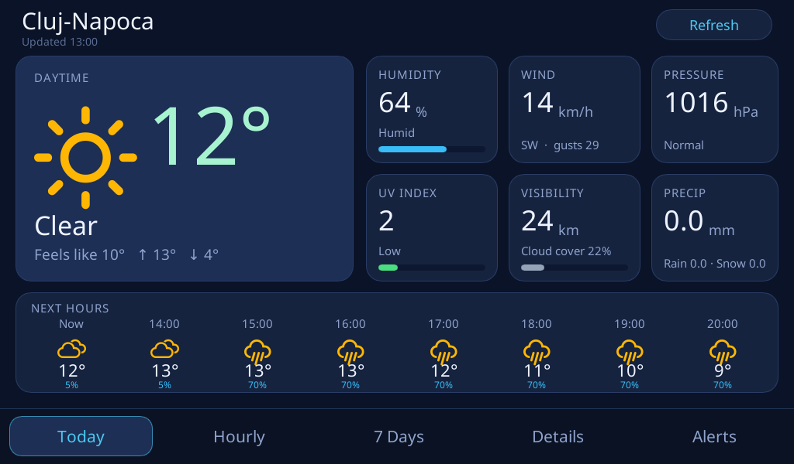 | 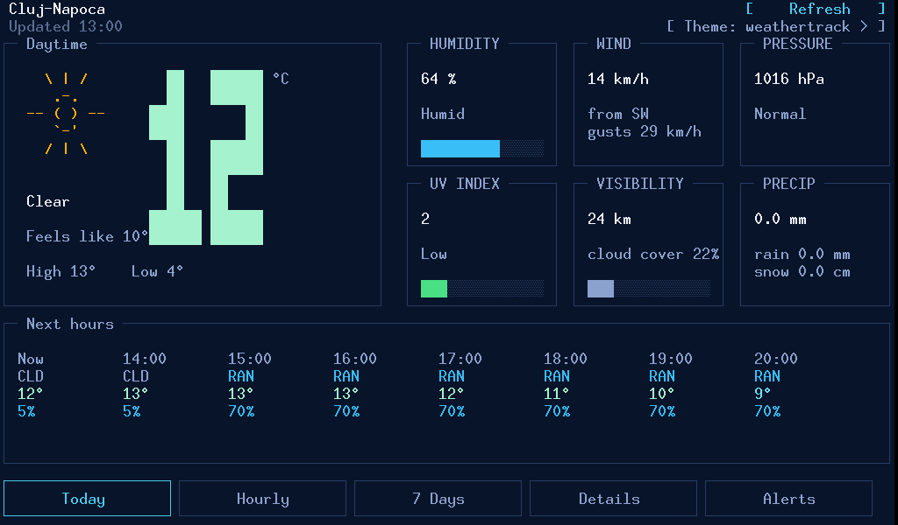 |
| **ESP32-C6, 1.47" LCD** (320×172, shown 3×) | 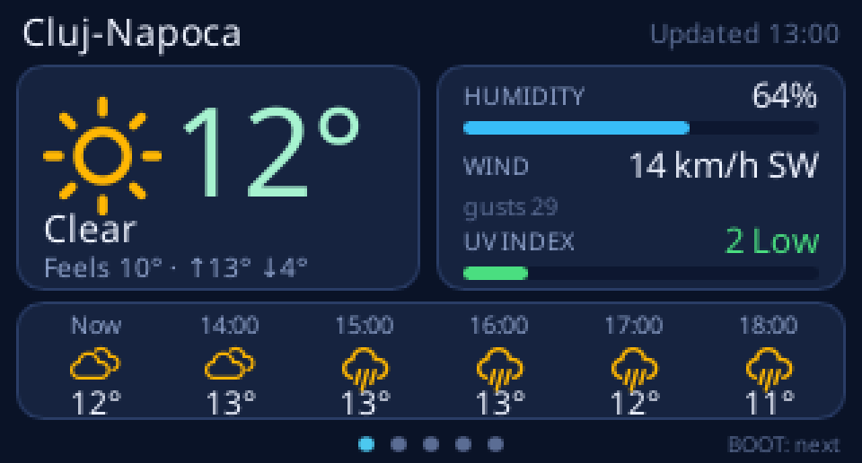 | 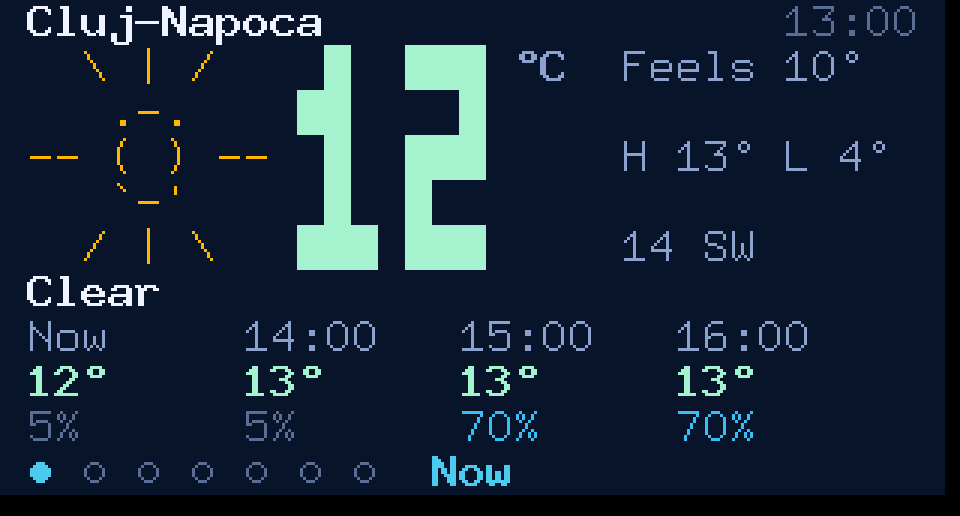 |

Hourly chart in the Slint UI:

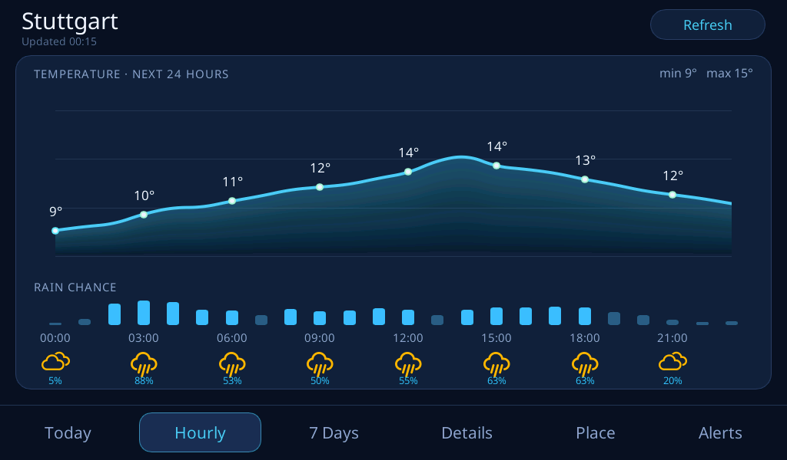

The terminal UI draws its charts with [tui-chart](https://github.com/sorinirimies/tui-chart): a smoothed braille line chart with a rain sparkline, a dumbbell chart for the 7-day low/high, and gauge widgets (dial, ring, arc, segments) for wind, humidity, pressure and UV.

| Hourly | 7 days | Details |
|---|---|---|
| 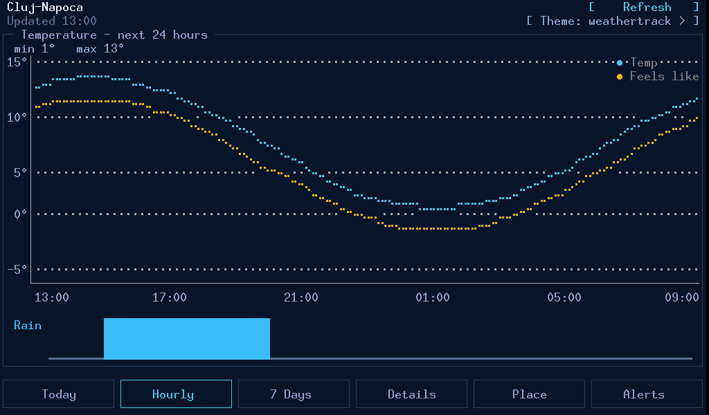 | 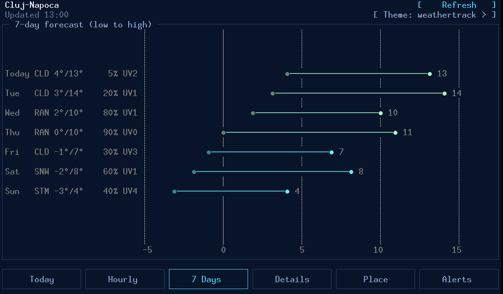 | 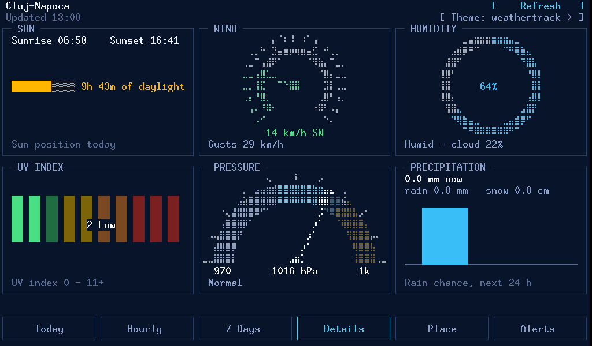 |

### Made to be read from a distance (C6)

The C6's 320×172 screen is small, so its UIs trade density for size: **nothing under 12 px, one idea per page, headline numbers 40–84 px**. Both UIs have seven pages (now, next hours, 24-hour chart, week, wind + humidity, UV + pressure, sun + rain) plus an alerts page, flipped with the BOOT button. The terminal UI uses a 9×15 font (35×11 cells) with block-letter digits.

| Slint · now | Slint · wind + humidity | Terminal · now | Terminal · wind + humidity |
|---|---|---|---|
|  | 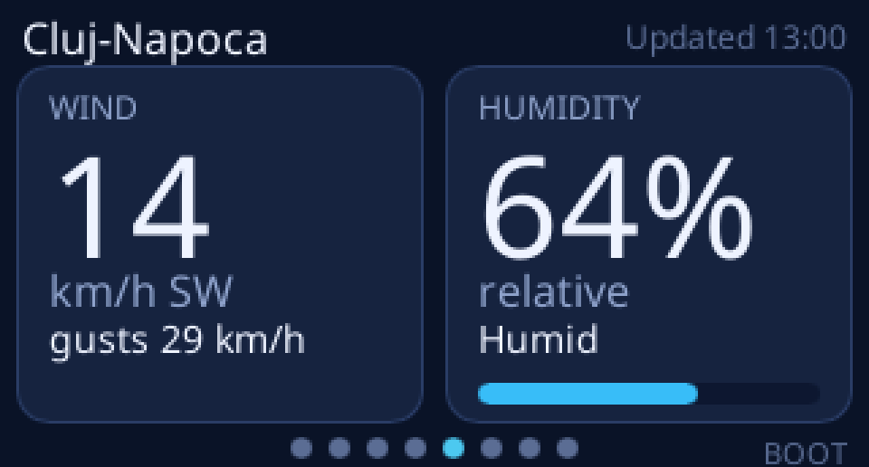 |  | 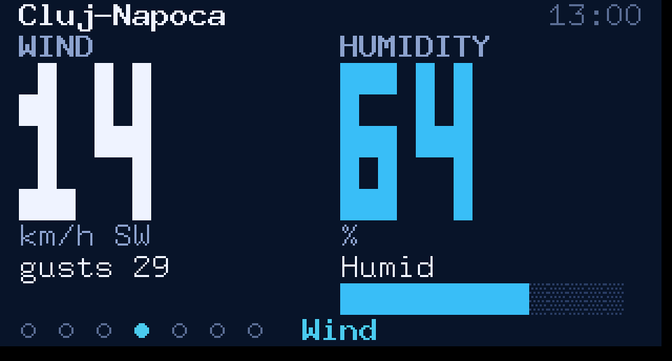 |

Terminal UI, 7 days on the C6:

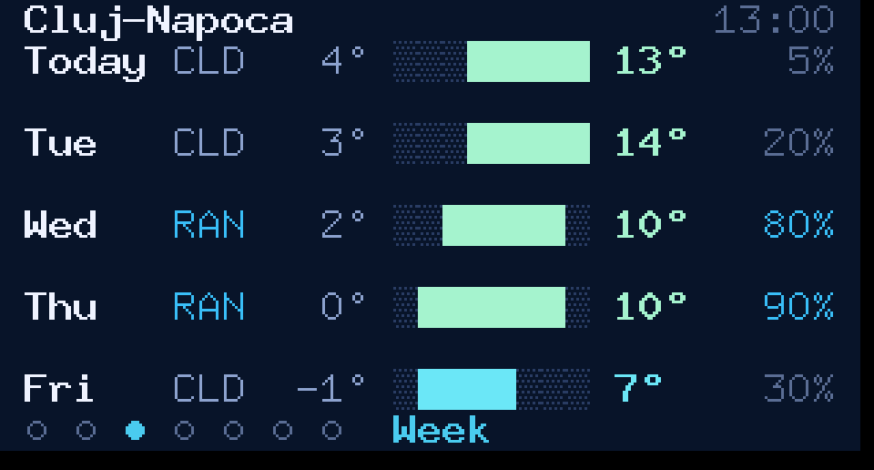

### Themes

The terminal UI is themed with [tui-nuances](https://github.com/sorinirimies/tui-nuances): WeatherTrack (the default), Catppuccin, Tokyo Night, Nord, Dracula, Gruvbox, Solarized (dark and light), One Dark, Rosé Pine, Monokai, Kanagawa, Everforest, Night Owl, Synthwave, Pip-Boy, Porsche, High contrast, GitHub Light. Text, borders and chart colours are contrast-checked against each theme's background, so light themes stay readable.

- **C6:** a short BOOT press changes the page, **holding BOOT (0.8 s) changes the theme**.
- **P4:** tap **Theme: name >** under the Refresh button.
- The choice is kept in flash across reboots. `just preview-themes` renders every theme.

| P4 · Nord | C6 · Catppuccin Latte (shown 3×) |
|---|---|
| 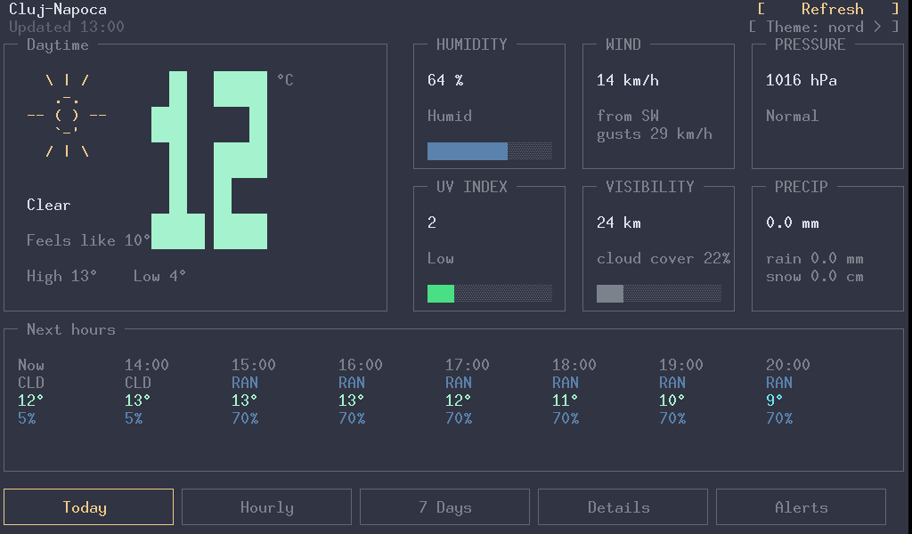 | 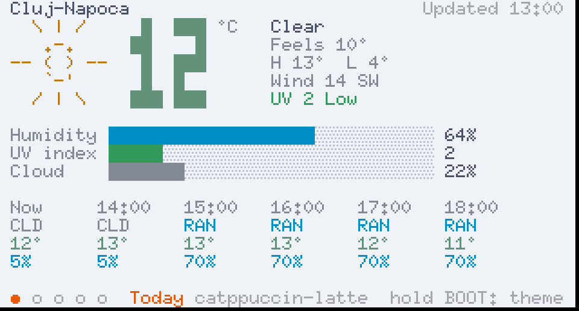 |

## Architecture

The project follows the **Elm architecture** pattern: `Model → Msg → update → view`.

```
weathertrack-tui ─┐                          ┌─ weathertrack-tui-ui (ratatui)
weathertrack-gui ─┼─▶ weathertrack-view ◀────┤
weathertrack-p4  ─┘        │                 └─ Slint bridge (weathertrack-view/slint)
                           ▼
                   weathertrack-core ──▶ Open-Meteo API
```

The workspace is split into these crates:

| Crate | Purpose |
|-------|---------|
| `weathertrack-core` | Shared logic — types, API URL building, JSON parsing, WMO weather codes, alerts. Platform-agnostic, testable on any host. |
| `weathertrack-tui` | Ratatui-based terminal UI rendered on the ST7789 LCD via embedded-graphics. |
| `weathertrack-view` | Presentation layer shared by every UI: formatted values, hourly window, chart geometry, sample data. Host-tested. |
| `weathertrack-tui-ui` | The ratatui UI (charts from `tui-chart`, themes from `tui-nuances`), responsive: compact (≈53×17 cells, C6) and wide (≈102×30 cells with a touch tab bar, P4). |
| `weathertrack-gui` | Slint UI for the C6's 320×172 LCD (BOOT button changes page). |
| `weathertrack-p4` | 7" ESP32-P4 firmware (MIPI-DSI panel, GT911 touch, WiFi via the C6 coprocessor) with two UIs chosen by cargo feature: `slint-ui` (default) or `tui`. Its own crate because the P4 needs newer `esp-idf-*` crates. |
| `weathertrack-p4-preview`, `-gui-preview`, `-tui-preview` | Host-side renderers: draw every page of a UI to PNG with sample data, so the UI can be checked without a board (`just preview-p4`, `preview-gui`, `preview-tui`). |
| `weathertrack-hal` | ESP32 hardware helpers shared by the C6 firmware. |

The core crate has no ESP32 dependencies and is the only workspace member. The firmware crates are excluded from the workspace (they need the ESP toolchain and their own `.cargo/config.toml`) and build separately.

## Hardware

- **Board**: [Waveshare ESP32-C6-LCD-1.47](https://www.waveshare.com/wiki/ESP32-C6-LCD-1.47)
- **MCU**: ESP32-C6 (RISC-V, `riscv32imac-esp-espidf`)
- **Display**: 1.47" ST7789 TFT, 172×320 pixels, SPI @ 40 MHz (landscape 320×172)
- **LED**: WS2812B RGB on GPIO8 (status indicator)
- **Button**: BOOT on GPIO9 (page navigation)
- **WiFi**: 802.11 b/g/n (built-in)

### Pin Mapping

| Function | GPIO | Notes |
|----------|------|-------|
| SPI SCLK | GPIO6 | Display clock |
| SPI MOSI | GPIO7 | Display data |
| LCD CS | GPIO14 | Chip select |
| LCD DC | GPIO15 | Data/command |
| LCD RST | GPIO21 | Reset |
| LCD BL | GPIO22 | Backlight |
| WS2812 LED | GPIO8 | RGB status LED |
| BOOT Button | GPIO9 | Page navigation |

## Getting Started

### Prerequisites

- [Rust](https://rustup.rs/) (nightly toolchain for ESP32 crates)
- ESP-IDF toolchain via [espup](https://github.com/esp-rs/espup)
- [espflash](https://github.com/esp-rs/espflash) for flashing
- [just](https://github.com/casey/just) task runner
- [nu](https://www.nushell.sh/) (for scripts and tests)
- [git-cliff](https://github.com/orhun/git-cliff) (for changelog generation)

### Build & Flash

1. Clone the repository:

   ```sh
   git clone https://github.com/sorin-irimies/esp32-c6-weathertrack.git
   cd esp32-c6-weathertrack
   ```

2. Copy `config.toml.example` to `config.toml` (git-ignored) and set your WiFi. It is baked into the firmware at build time. **The weather follows where the device is**: on every boot its location is looked up from the network (IP geolocation, city level). The `[location]` place in `config.toml` is only the fallback if that lookup fails; set `fixed = true` there to pin it instead.

3. Build and flash (release mode recommended for performance):

   ```sh
   just run-tui-release    # Ratatui frontend, ESP32-C6
   just run-gui-release    # Slint frontend, ESP32-C6
   just flash-p4           # 7" touch app, ESP32-P4 (builds, flashes, opens the monitor)
   just build-p4-tui-release  # the same P4 firmware with the terminal UI
   ```

   Before the first P4 flash, `just backup-p4` saves the board's original firmware.
   Preview the P4 UI without hardware: `just preview-p4` writes PNGs to `target/p4-ui/`.

## Development

List all available commands:

```sh
just --list
```

Common workflows:

| Command | Description |
|---------|-------------|
| `just check-all` | The CI gate — fmt, clippy, tests, P4 UI tests, docs, version check, unused deps, nu tests |
| `just test` | Rust tests (core) |
| `just test-nu` | Nushell script tests |
| `just fuzz-all` | Short run of every fuzz target (nightly + cargo-fuzz) |
| `just audit` / `just deny` | Known vulnerabilities / licenses, bans, sources |
| `just secrets` | Scan the git history for secrets (gitleaks) |
| `just check-firmware` | Build every firmware image (slow, needs the ESP toolchain) |
| `just changelog` | Generate changelog with git-cliff |
| `just bump X.Y.Z` | Bump the version, update the changelog, commit and tag |

### CI

GitHub and Gitea both run the gate on every push. Nightly workflows update the lockfiles, run
`cargo audit` and `cargo deny`, scan the history with gitleaks and fuzz every target
(`fuzz/fuzz_targets`: forecast and location parsing, cache JSON, WMO/alert mapping). The
firmware itself is not built in CI (the ESP toolchain needs ~10 minutes and several GB); run
`just check-firmware` before a release. Commits follow [Conventional Commits](https://www.conventionalcommits.org);
`CHANGELOG.md` is generated by git-cliff.

## Project Structure

```
esp32-c6-weathertrack/
├── Cargo.toml                  # Workspace root (core only; firmware crates excluded)
├── cliff.toml                  # git-cliff changelog config
├── deny.toml, clippy.toml      # cargo-deny and clippy policy
├── justfile                    # Task runner recipes (Nushell)
├── config.toml.example         # WiFi + location (copy to config.toml)
├── crates/
│   ├── weathertrack-core/      # Shared library (no ESP32 deps): types, Open-Meteo parsing, WMO codes
│   ├── weathertrack-view/      # Presentation layer: formatted values, chart geometry, sample data
│   │   └── slint/              # Slint data types + bridge shared by the two Slint UIs
│   ├── weathertrack-tui-ui/    # Responsive ratatui UI (compact C6 / wide P4)
│   ├── weathertrack-hal/       # ESP32-C6 hardware helpers
│   ├── weathertrack-tui/       # C6 firmware: ratatui UI on the 172x320 LCD
│   ├── weathertrack-gui/       # C6 firmware: Slint UI on the 172x320 LCD
│   ├── weathertrack-p4/        # P4 firmware: Slint (default) or ratatui UI on 1024x600 MIPI-DSI
│   │   ├── ui/                 # app.slint, pages/, components/, theme.slint
│   │   ├── src/                # main, hw (frame buffer, touch), ui_slint, ui_tui, wifi, net
│   │   └── components/wt_display/  # C shim: EK79007 panel, backlight, GT911
│   └── weathertrack-*-preview/ # Host renderers: every page of each UI to PNG
├── fuzz/                       # cargo-fuzz targets for the core parsers
├── .github/, .gitea/           # CI, release, nightly security / fuzz / deps / secrets
└── scripts/
    ├── esp.nu                  # sdkconfig generation, P4 flash + backup
    ├── project.nu              # What a release ships (BINS, PUBLISH, …)
    ├── ci/                     # Quality gate, release, nightly helpers
    └── tests/                  # Nushell tests for all of the above
```

## License

MIT
